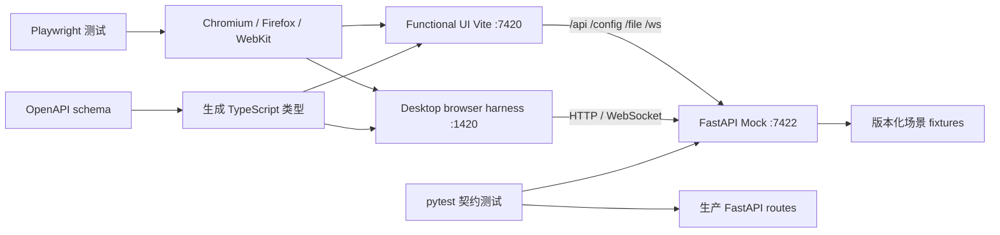

# SSUI 前端自动化测试方案

## 1. 目标与边界

这套方案验证两件事：

1. 用户可见的 UI 功能能够在真实浏览器中完成，包括动态表单、执行、结果展示、设置、模型管理、任务队列、文件上传和错误恢复。
2. 前端发出的 HTTP/WebSocket 请求与后端约定一致。测试后端不加载模型、不生成真实图片，但必须返回与生产环境同结构的数据，并能模拟进度、失败、超时和重连。

默认 E2E 不启动模型、CUDA、executor 或 Tauri 壳，以保证开发机和 CI 都能快速稳定运行。少量 Tauri 壳能力另设平台 smoke test。

## 2. 当前代码与主要缺口

### 2.1 已有基础

- `frontend/functional_ui` 是 Vite + React 应用，通过查询参数选择 `functional`、`code_editor`、`workflow`、`project_settings`、`image_preview` 等视图。
- `frontend/ssui_components` 已有 Jest 测试，并有一个测试 FastAPI/WebSocket 服务。
- `server.create_app()` 已支持服务依赖注入；Python 路由测试使用 `TestClient` 和 `tests/mocks.py`。
- `desktop` 已有 Storybook stories 和多个 Provider mock。
- CI 已跨 Windows、macOS、Linux 构建并运行部分 Jest/Python 测试。

### 2.2 风险与缺口

- 没有浏览器级 E2E，动态表单的“加载脚本 → 准备参数 → 提交执行 → 更新输出”没有完整覆盖。
- 现有前端测试只覆盖共享组件中的少数逻辑；`functional_ui`、`desktop` 和 Image Canvas 基本没有自动化交互测试。
- `Message.test.ts` 依赖固定等待 3 秒和独立端口，容易慢、冲突和残留进程。
- 前后端共享契约较弱：大量响应在 TypeScript 中是局部 interface 或 `any`，部分 FastAPI 路由也没有声明 `response_model`。
- WebSocket 至少有两类协议：`uuid/callback/finish` 和任务队列的 `task_update`，目前没有统一契约测试。
- desktop 直接依赖 Tauri API。若不抽象运行时边界，普通 Chromium 无法完整启动它。
- 当前 CI 只运行 `ComponentsManager.test.ts`，并未运行共享组件的完整 Jest suite。

## 3. 推荐的测试金字塔

| 层级 | 工具 | 验证内容 | 运行时机 |
|---|---|---|---|
| 静态检查 | TypeScript、现有 build | 类型、打包、导入与资源 | 每次 PR |
| 单元/组件 | Vitest + React Testing Library；旧 Jest 渐进迁移 | 控件输入输出、状态、错误分支、Provider | 本地 watch、每次 PR |
| API 契约 | pytest + FastAPI TestClient + OpenAPI schema | 状态码、请求体、响应体、错误结构、WS 消息 | 每次 PR |
| 浏览器 E2E | Playwright Chromium | 真实 DOM、网络、动态 UI、关键用户旅程 | 每次 PR |
| 跨浏览器 | Playwright Chromium/Firefox/WebKit | 浏览器兼容性 | dev 分支、每日或每周 |
| Tauri smoke | WebdriverIO + tauri-driver（Linux/Windows）及 macOS 可执行文件 smoke | 原生 WebView 启动、React 初始化、安装/就绪状态 | 发布候选 |
| 真后端回归 | Playwright + 正常 FastAPI/executor | mock 未覆盖的集成差异，不运行大模型 | nightly/发布前 |

组件层建议采用 Vitest，是因为三个 React 前端均由 Vite 构建，可共享配置、原生支持 ESM，并减少 Jest/ts-jest 配置摩擦。已有 Jest 不必一次性迁移：第一阶段保留原测试，新测试使用 Vitest，稳定后再迁移。

## 4. 总体架构



浏览器测试必须通过与开发环境相同的 Vite proxy 访问 API。这样既覆盖 URL、query、method、body 和代理配置，又不会把测试绑定到跨域细节。

## 5. 建议目录

```text
tests/
  contract/
    test_openapi_contract.py
    test_websocket_contract.py
  mock_api/
    __main__.py
    app.py
    scenarios.py
    fixtures/
      functional_happy.json
      task_lifecycle.json
      model_catalog.json
      errors.json
  e2e/
    playwright.config.ts
    fixtures/
      test.ts
    pages/
      functional.page.ts
      queue.page.ts
      settings.page.ts
    specs/
      functional-ui.spec.ts
      settings.spec.ts
      model-manager.spec.ts
      queue.spec.ts
      file-views.spec.ts
      accessibility.spec.ts
    assets/
      input.png
      generated.png
  tauri-e2e/
    ...
frontend/
  test-utils/
    render.tsx
    handlers.ts
    server.ts
```

Playwright 放在根目录测试区，而不是某个 workspace 内，因为它要同时覆盖 Functional UI、desktop browser harness 和 Image 扩展。

## 6. Mock API 设计

### 6.1 实现原则

Mock API 使用 FastAPI，并复用生产 Pydantic 模型和路由输入输出模型。不要只在 Playwright 中逐条 `page.route()` 伪造成功响应；那种方式适合单个异常分支，却无法验证 Vite proxy、真实 HTTP 序列化和 WebSocket。

推荐两种复用方式：

- 对现有路由：调用 `server.create_app()`，注入 deterministic 的 `MockScriptService`、`MockModelService`、`MockTaskScheduler`、`MockWebSocketService` 和临时 `TaskService`。
- 对难以隔离的外部下载接口：在 mock profile 中用同路径路由替代实现，但返回类型仍引用生产 Pydantic schema。

Mock 进程通过 `SSUI_TEST_SCENARIO` 或测试专用控制接口选择场景。控制接口只存在于测试 app，例如：

```http
PUT /__test__/scenario
Content-Type: application/json

{"name":"generation-fails"}
```

每条 Playwright 测试开始时重置场景和内存状态，禁止测试之间共享队列或配置。

### 6.2 核心响应示例

`GET /api/script` 返回真实动态 UI 所需结构：

```json
{
  "root_path": "/fixtures/demo",
  "functions": {
    "generate": {
      "params": {"prompt": "str", "image": "Image"},
      "returns": ["Image"]
    }
  }
}
```

`POST /api/prepare` 返回真实 Controller 类型、参数和默认值：

```json
{
  "Generation": {
    "steps": {"controller": "int", "args": {"min": 1, "max": 50}, "default": 20},
    "seed": {"controller": "int", "args": {}, "default": 42}
  }
}
```

`POST /api/execute` 不生成图片，返回测试 fixture 的可访问 URL，数组顺序必须和 `returns` 一致：

```json
[
  {"path": "/__test__/assets/generated.png", "width": 512, "height": 512}
]
```

实际字段应以各 `ComponentRef.onUpdate()` 消费的结构为准。落地前先为 Image/Audio/Video/String 等组件补齐具名响应模型，避免 fixture 猜字段。

WebSocket mock 必须支持：

- 连接后发送 `{"type":"uuid","uuid":"client-1"}`；
- 异步任务按顺序发送 `callback` 和 `finish`；
- 下载/生成队列发送 `task_update`；
- 可配置 callback 先于 HTTP 响应到达，用于覆盖 `message_cache`；
- 可配置中途断线、重复消息和失败 finish，用于覆盖重连与幂等。

### 6.3 场景清单

至少内置以下场景：

| 场景 | 行为 |
|---|---|
| `happy-path` | 所有接口成功，固定 seed、固定任务 ID、固定图片 |
| `slow-generation` | prepare 正常，execute 延迟并推送 10/50/100% |
| `generation-fails` | execute 或 finish 返回结构化错误 |
| `empty-models` | 模型列表为空 |
| `api-500` | 指定接口返回 500 |
| `invalid-contract` | 仅用于证明契约校验能拦截错误 fixture |
| `ws-reconnect` | 首次连接主动断开，第二次恢复 |
| `upload-rejected` | 413、错误 MIME 或无效 JSON |
| `offline-config` | 配置加载失败，验证 localStorage 回退 |

## 7. API 契约治理

契约应以 FastAPI/Pydantic 为唯一事实来源：

1. 为当前未标注的路由补充请求和响应模型，包括 ScriptMeta、PrepareDetails、ExecuteResult、TaskList、TaskMutation、模型列表、上传和统一错误。
2. 为 WebSocket 消息定义 discriminated union：`uuid | callback | finish | task_update`。
3. 在 CI 导出 `app.openapi()`，用 `openapi-typescript` 生成前端只读类型文件。
4. CI 重新生成后执行 `git diff --exit-code`，防止后端改契约而忘记更新前端。
5. pytest 同时用同一 schema 验证生产 app 响应和 mock app fixtures，确保 mock 不会“自己测自己”。

错误响应统一建议为：

```json
{
  "error": {
    "code": "EXECUTION_FAILED",
    "message": "Generation failed",
    "retryable": true,
    "details": {}
  }
}
```

现阶段可先记录旧接口差异并渐进统一，不要为了测试一次性破坏兼容性。

## 8. 浏览器 E2E 用例矩阵

### 8.1 Functional UI（PR 必跑）

- 带 `?path=` 打开页面，请求 script meta，默认选中第一个 callable。
- 切换 callable 后重新请求 prepare，并更新输入、输出和 Details。
- 输入 prompt、上传测试图片、调整 details，点击 Run；断言请求 body，而不只断言页面最终出现图片。
- execute 成功后，结果组件展示 mock 图片且尺寸/来源正确。
- script、prepare、execute 分别失败时显示可理解错误，并允许重试。
- `auto_open_details`、主题和配置缓存行为正确。
- code editor 读取、编辑、上传 JSON；image preview 和 workflow 视图能加载。

### 8.2 Desktop UI（PR 中 browser harness，发布前 Tauri smoke）

- 导航切换工作区、模型、队列、扩展，页面状态不串扰。
- 模型列表加载、搜索、空态、服务端错误；预设/HuggingFace/Civitai 请求参数正确。
- 队列初始拉取、WebSocket 增量更新、轮询兜底、取消、删除、清理已完成任务。
- server/executor 状态展示及重启确认对话框。
- 新建工作流对话框和 Tab 打开逻辑。
- Tauri smoke 只验证文件选择、真实资源路径、server/executor 进程和 WebView URL；业务 DOM 不在此层重复测试。

为了让 desktop 在普通浏览器可测，应新增 `RuntimeAdapters` 注入层，集中包装 dialog、fs、path、invoke、process 等 Tauri API。生产使用 Tauri adapter，Storybook/Playwright 使用 browser mock adapter。现有 Provider mock 可直接扩展，不应在测试中全局 monkey-patch 每一个 Tauri import。

### 8.3 Image Canvas

- 新建/选择/移动/缩放图层，撤销重做，视口缩放与坐标转换。
- 上传输入图片后构建的请求正确。
- AI 绘图请求显示 loading、成功结果、失败恢复。
- Canvas 像素级行为用少量截图对比；业务行为优先断言对象状态和可见控件，避免大量脆弱 snapshot。

### 8.4 非功能验证

- 使用 `@axe-core/playwright` 检查关键页面无严重/致命可访问性问题。
- 仅对稳定区域做 Playwright screenshot；不同 OS/浏览器分别存基线。
- 收集 console error、page error 和失败请求；除测试声明允许外，出现即失败。
- 每个测试使用 role/label/test id 定位，禁止依赖 Blueprint 内部 DOM 层级或 CSS module 哈希。

## 9. Playwright 配置要点

- `webServer` 同时启动测试 FastAPI（7422）和 Functional UI（7420），使用健康检查而非固定 sleep。
- CI 默认 Chromium、1 worker 或按文件有限并发；跨浏览器放 nightly，避免现有 CI 三 OS 矩阵再次乘三。
- `trace: 'retain-on-failure'`、`screenshot: 'only-on-failure'`、`video: 'retain-on-failure'`。
- 重试仅 CI 设为 1；本地不重试，以尽早暴露 flaky。
- 测试数据和下载目录使用每 worker 独立临时目录。
- 禁止访问 Civitai、HuggingFace 等公网；未 mock 的外部请求直接失败。
- 测试脚本等待具体 UI 状态或响应，不用 `waitForTimeout()`。

建议根脚本：

```json
{
  "test:unit": "yarn workspaces run test:unit",
  "test:contract": "node dependencies/venv.cjs python -m pytest tests/contract",
  "test:e2e": "playwright test -c tests/e2e/playwright.config.ts",
  "test:e2e:ui": "playwright test -c tests/e2e/playwright.config.ts --ui",
  "test:frontend": "yarn test:unit && yarn test:contract && yarn test:e2e"
}
```

具体脚本落地前仍应遵守本仓库约定，在对应 `package.json` 中定义后再由 CI 调用。

## 10. CI 门禁

建议在现有 CI 中拆成以下 jobs：

1. `frontend-unit`：Linux，运行全部共享组件、Functional UI、desktop browser components、Image Canvas 单元测试。
2. `api-contract`：Linux，运行生产/Mock API 契约与 WebSocket 测试。
3. `e2e-chromium`：Linux，构建共享组件，启动 mock + Vite，运行 PR 关键路径。
4. `build`：保留现有三平台构建，不再在每个平台重复完整浏览器 E2E。
5. `e2e-cross-browser`：定时任务或 dev 分支运行 Firefox/WebKit。
6. `tauri-smoke`：发布候选运行；失败产物上传 trace、视频、截图和应用日志。

PR 必须通过的首批用例建议控制在 5 分钟内：Functional UI happy path、execute 失败、设置持久化、任务队列 lifecycle、模型空态/成功态、一个上传流程。

## 11. 稳定性和可测试性规范

- 对关键控件添加稳定且语义化的 label；无法用 role/label 唯一定位时才添加 `data-testid`。
- 将 API client 从 React 组件中抽出并注入；组件测试注入 fake，E2E 走真实 HTTP。
- 所有定时器、随机 ID、时间戳和 seed 在 mock 中可控。
- API client 必须检查 `response.ok`、解析统一错误并设置超时/取消策略。
- WebSocket client 明确连接状态、退避策略、最大重试和消息去重；用 fake timers 做单元测试、mock server 做集成测试。
- 每个 E2E 独立创建数据，不依赖执行顺序。
- 不对动画中的 DOM、当前时间文本、随机 UUID 做精确截图断言。

## 12. 分阶段落地

> 实施状态（2026-08-23）：三个实施阶段的代码设施已落地。现已具备 deterministic FastAPI mock、契约和类型漂移门禁、组件/Canvas 测试、Chromium PR E2E、定时三浏览器 E2E、axe 可访问性检查，以及 Linux/Windows 原生 Tauri WebDriver smoke 入口。发布流水线继续在 Windows/macOS 验证打包产物可执行；真 executor 的定时集成回归和 flaky 趋势统计属于后续 CI 运营项，未伪装成当前已自动化的能力。

### Phase 1：最小闭环（建议第一个 PR）

- 引入 Playwright 和 pytest 契约测试目录。
- 实现 FastAPI mock 的 `happy-path`、`generation-fails`、`task-lifecycle`。
- 覆盖 Functional UI 一条完整生成链路与 Queue 一条生命周期链路。
- 修正 CI 只运行单个 `ComponentsManager` 测试的问题，改为完整 suite。
- 建立失败 trace/截图上传。

验收：全新环境无需模型/GPU，单命令可完成 UI → HTTP → WebSocket → 图片 fixture 展示，CI 可稳定重复运行。

### Phase 2：契约和组件测试

- 补齐 Pydantic response models，生成 TypeScript API 类型。
- 引入 Vitest、Testing Library、MSW；覆盖错误、空态和主要控件。
- 为 desktop 建立 RuntimeAdapters/browser harness。
- 覆盖设置、模型、文件视图和上传。

### Phase 3：长尾与发布保障

- Image Canvas 行为和少量视觉回归。
- 跨浏览器 nightly、可访问性检查。
- Tauri smoke 和真 FastAPI/executor（无大模型）集成测试。
- 建立 flaky 统计；不允许长期用 retry 掩盖不稳定测试。

## 13. 完成标准

一套功能只有同时满足以下条件才视为测试完整：

- 主成功路径有浏览器 E2E；关键失败/空态至少有组件或 E2E 覆盖。
- 前端请求 method、path、query 和 body 有断言。
- 生产 API 和 mock fixture 都通过同一契约校验。
- WebSocket 流程覆盖完成、失败和至少一种乱序/重连情况。
- CI 失败能提供 trace、截图、控制台和 mock server 日志。
- 测试不依赖公网、GPU、真实模型、固定 sleep 或开发者本机文件。

按此方案实施后，PR 的主要反馈来自快速、确定性的浏览器与契约测试；真实模型测试继续保留在现有显式开关和发布回归中，二者职责不会混在一起。
